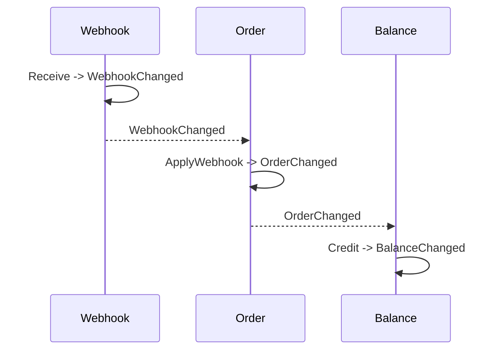

# Design Event-Driven Aggregates

Treat this skill as an architecture contract. Apply `define-aggregate-boundaries` first and use its approved small-root map, lock boundaries, and vocabulary as prerequisites. Then apply this skill before layer-, framework-, or language-specific implementation skills. Do not weaken either skill, repository architecture rules, or an approved aggregate model to make implementation easier. Surface conflicts and require an explicit owner decision.

This is event-driven state persistence, not event sourcing. Aggregate snapshots remain authoritative unless the project explicitly adopts event sourcing and its additional replay, upcasting, retention, and stream-concurrency guarantees.

## Non-Negotiable Rules

1. Assign every persistent business object to an explicit aggregate root and consistency boundary.
2. Treat any identity-bearing record with business lifecycle or transition rules as domain state, even when named webhook, notification, inbox item, job, or evidence. Keep purely technical deduplication and transport records in infrastructure.
3. Change aggregate state only through root constructors and intention-revealing methods that enforce invariants.
4. Make every successful persistent transition emit one or more typed state-change events. Event production follows the transition, not the existence of current consumers.
5. Create lifecycle events inside the aggregate transition. Application services, repositories, delivery handlers, and consumers must not invent them.
6. Persist one aggregate root and append its events to a durable transactional outbox in the same transaction. Use Vibox when the project provides it; otherwise use an equivalent mechanism with the same atomicity.
7. Let one application command and transaction mutate at most one aggregate root, including its owned children and rows. Inbox deduplication and outbox records are technical participants, not additional roots.
8. Coordinate changes to another aggregate through a durable event consumer that issues a command against that target aggregate.
9. Make consumers safe for at-least-once delivery, retries, replay, concurrency, and documented ordering limits.
10. Require a narrow, documented, owner-approved architecture exception before violating these rules.

Do not replace an event chain with an application transaction script that loads and writes several aggregate roots.

## State-Change Event Contract

Use a stable envelope containing:

```text
event_id
event_type
schema_version
aggregate_type
aggregate_id
aggregate_version
occurred_at
correlation_id
causation_id
actor_or_source
before
after
```

Apply these rules:

- Use `before = null` for creation and `after = null` for deletion.
- Use immutable, deep-copied `before` and `after` snapshots for updates.
- Default to the complete publishable aggregate state. Use a stable event snapshot type rather than serializing implementation or persistence structs.
- Exclude secrets, credentials, unsafe personal data, and unbounded payloads. Document intentional omissions without removing the semantic before/after change.
- Increment `aggregate_version` monotonically for each transition.
- Generate an event ID once and preserve it through retries.
- Propagate correlation ID and set causation ID to the request, external message, or parent event that caused the transition.
- Version event schemas compatibly; never redefine the meaning of an already-published event.

Rejected commands and true no-ops emit no state-change event. An identical replay must reuse the original outcome. If observing every repeated delivery matters, model `Observed` or receipt metadata as a real transition instead of publishing a false `Changed` event.

## Aggregate Transition Shape

Implement a transition in this order:

1. Validate the command, current state, and invariants.
2. Capture an immutable `before` snapshot.
3. Apply the state change.
4. Increment aggregate version.
5. Capture an immutable `after` snapshot.
6. Create and return or record the event.

Keep creation separate from rehydration. Rehydration restores persisted state and emits nothing. Prevent callers from directly assigning lifecycle fields.

Keep aggregate methods deterministic. Pass IDs, time, authenticated external facts, and other nondeterministic inputs into the method; do not call databases, brokers, clocks, random generators, or remote providers from the aggregate.

## Command and Transaction Shape

Implement a state-changing command as:

```text
begin transaction
load or create one aggregate root
invoke one aggregate transition
save the root and all owned state
append every returned event to the transactional outbox
commit
```

Rollback state and events together. Never commit a transition without its event or publish an event for state that did not commit.

Use one repository per aggregate root for writes. Hide owned child tables behind that repository. Prefer version-aware `Load`/`Save(expectedVersion)` semantics where supported. Keep read models and projection repositories separate from aggregate persistence.

Perform remote reads outside database transactions, validate the returned facts, and pass them into the command. Model external side effects through durable intent/result steps when failure ambiguity matters; use stable idempotency keys.

Treat a gateway `(result, error)` pair as a possible ambiguity contract rather than assuming errors imply no result. Persist a returned ambiguous outcome and its stable recovery identity before retrying. A missing provider-generated ID is not proof that the provider did nothing and must never authorize an automatic duplicate side effect.

For replay of a terminal reconciliation command, compare the effective persisted provider identity. If the command legitimately omits an optional provider ID, reuse the aggregate's already-bound ID for the idempotency check; otherwise a lost successful HTTP response can turn an identical retry into a false conflict.

## Consumer Shape

Implement a state-changing consumer as:

```text
receive event
begin transaction
deduplicate by (consumer identity, event_id)
load or create one target aggregate
invoke its transition with causation metadata
save that aggregate and owned state
append its returned events
record successful consumption
commit
acknowledge
```

Make deduplication, target mutation, emitted events, and consumed-position progress atomic where the transport permits it. Acknowledge only after commit. Use locks or optimistic versions. Handle out-of-order events explicitly; never assume global ordering.

Consumers that change business state must call an application command and aggregate behavior. Only disposable, rebuildable projections may write projection storage directly. A saga or process manager may coordinate a workflow, but each step still targets one aggregate and communicates durably.

## Required Design Workflow

Before this workflow, confirm that `define-aggregate-boundaries` has established one simple business purpose, one write repository, and one `SELECT FOR UPDATE` boundary for every root. Stop and resolve broad, vague, unlocked, or multi-root designs before defining their events.

### 1. Discover the state model

Inspect current write paths, entities, repositories, services, transactions, schemas, event infrastructure, topics, consumers, retries, and generated-code boundaries. Find:

- services that write several business objects;
- lifecycle structs owned by repository packages;
- direct lifecycle field assignment;
- application-created events;
- webhook handlers that synchronously reconcile downstream state;
- table polling used where a known state transition should emit an event.

Do not infer aggregate boundaries from tables, provider DTOs, protobuf messages, or existing service packages.

### 2. Produce the aggregate/event model

Before schema or production implementation, create or update an approved `domain-model.md` using [the model template](references/domain-model-template.md). Define:

- aggregate roots, identities, owned and excluded state, and invariants;
- commands, transitions, and the event emitted by every persistent change;
- event-safe before/after schemas;
- topics or streams, partition keys, ordering, consumers, and resulting commands;
- transaction boundaries, versions, idempotency, correlation, causation, retry, replay, and failure handling;
- external calls, projections, and any proposed exception.

Make the document Mermaid-first:

- show each major happy, failure, and recovery route as a `sequenceDiagram`;
- use participants named after actors, consumers, external systems, and
  aggregate roots;
- show transaction boundaries and events directly in the sequence;
- keep tables only for compact aggregate ownership and event-contract facts;
- do not repeat a route in prose when the diagram already communicates it;
- target a reviewable document under 200 lines unless genuinely distinct
  scenarios require more.

For webhook-driven state, prefer:



The webhook boundary may authenticate and normalize input. It must not synchronously mutate downstream order or balance aggregates.

### 3. Obtain approval

For a non-trivial feature, present the aggregate map, transition matrix, event contracts, event routes, and transaction boundaries for explicit owner approval before editing schemas or production code. Treat an unowned mutation, missing event, ambiguous consistency boundary, or multi-root transaction as a blocker.

For a narrow fix that does not change the approved topology, verify conformance and avoid expanding scope unnecessarily.

### 4. Implement domain-first slices

Implement one event-driven path at a time:

1. Event snapshot/envelope types and aggregate state.
2. Constructors, transitions, invariants, versions, and unit tests.
3. Aggregate repository and concurrency control.
4. Atomic aggregate persistence plus outbox append.
5. Thin application command: load, invoke, save, publish, commit.
6. Idempotent consumer and its next aggregate command.
7. Projections, delivery adapters, wiring, migrations, and generated code as required by the repository.
8. Operational metrics, tracing, retry, poison-message handling, and replay tooling.

Do not let migration or generated transport shapes dictate aggregate boundaries.

### 5. Verify the chain

Test at least:

- every successful transition and its exact immutable `before`/`after` event;
- creation/deletion null-snapshot semantics;
- failed and no-op transitions emit nothing and do not mutate;
- later aggregate mutation cannot alter prior event snapshots;
- aggregate save and outbox append commit or roll back together;
- duplicate delivery changes the target once;
- retry, replay, concurrency, and out-of-order delivery follow the documented policy;
- aggregate version, schema version, correlation, and causation propagate correctly;
- external effects use idempotency and ambiguous outcomes are recoverable;
- a durable aggregate transition claims each non-idempotent external effect before the call, and only the successful claimant can dispatch it;
- ambiguous external outcomes remain distinguishable from terminal business failures and cannot be automatically reissued without proven recovery;
- the end-to-end event chain reaches every intended aggregate and projection.

## Review Heuristics

Flag:

- passive lifecycle DTOs or public field mutation;
- repository contracts that expose table-shaped business records instead of aggregate persistence;
- application services or consumers constructing lifecycle events;
- one command writing multiple aggregate repositories;
- business consumers mutating tables directly;
- state and outbox commits that are not atomic;
- events conditional on current subscribers;
- events without meaningful before/after state;
- consumers without durable idempotency, version, or ordering behavior;
- synchronous webhook-to-downstream mutation;
- polling that substitutes for an already-known domain event;
- secrets, mutable aliases, or implementation structs in event snapshots;
- row-focused tests that omit aggregate events and end-to-end event routes.

When reviewing, report the violated rule, concrete evidence, failure mode, and smallest architecture-consistent correction.

## Exceptions and Governance

Allow a multi-root transaction or missing state-change event only through an explicit architecture decision that records:

- the exact rule and narrow operation being excepted;
- the invariant that cannot tolerate eventual consistency;
- why boundary redesign, choreography, or compensation is insufficient;
- replay, recovery, rollback, and observability consequences;
- compensating controls, owner, and review/removal condition.

Pure caches, telemetry, ephemeral runtime state, configuration, and rebuildable read projections are not aggregate transitions. Legacy code, deadlines, implementation cost, framework limitations, or absence of consumers are not implicit exceptions.

Do not modify this skill, governing agent instructions, or architecture decisions inside the feature change that they govern. Propose governance changes separately and require explicit owner review before using them to alter implementation rules.
