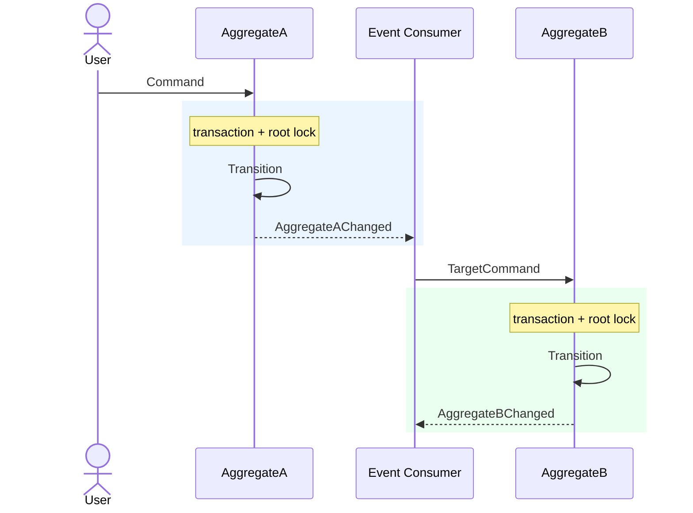
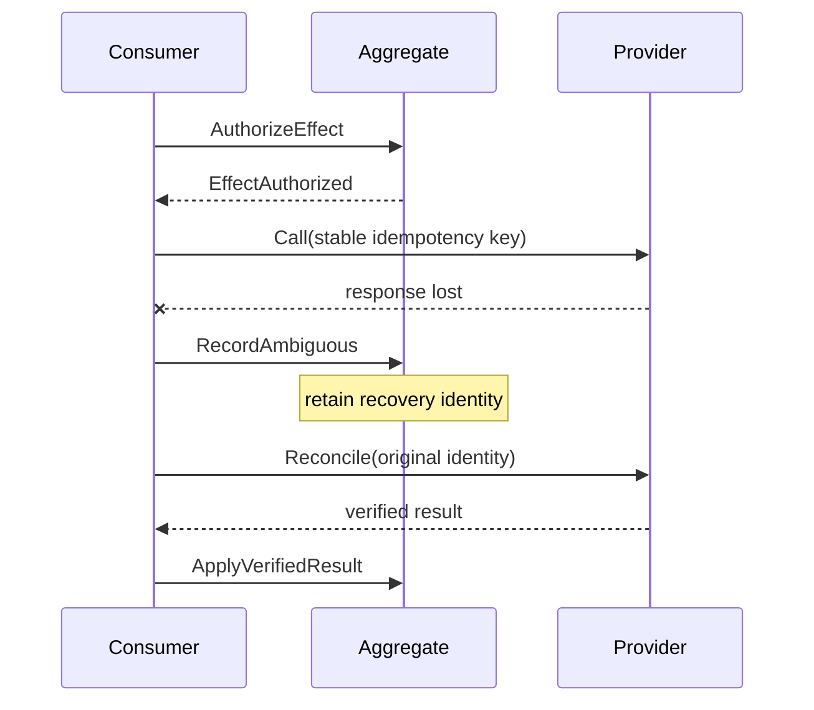

# Aggregate and Event Model: `<feature>`

- Status: Proposed | Approved
- Owner:
- Decision date:
- Related requirements:

## Aggregate Boundaries

Keep this table compact. Include only facts needed to judge the consistency
boundary.

| Root | Purpose | Identity | Owned state | Excluded state | Lock/invariant |
| --- | --- | --- | --- | --- | --- |
| `<Root>` | `<one sentence>` | `<ID>` | `<bounded state>` | `<other roots>` | `<canonical lock and immediate rule>` |

Decide explicitly whether lifecycle-bearing webhook, inbox, job, notification,
or evidence records are domain state or technical infrastructure.

## Main Flow

Use a Mermaid sequence diagram as the primary explanation:

Show commands, aggregate transitions, emitted events, consumers, external
systems, and where transactions begin/end. Use `alt`, `else`, `opt`, and `loop`
for outcome branches instead of describing the same route below the diagram.

## Failure and Recovery

Add only diagrams that materially differ from the main flow. Cover rejection,
duplicate delivery, retry after partial failure, out-of-order delivery,
ambiguous external outcomes, replay, and recovery without the original
transport message.

## Event Contract

Define the shared contract once, then list only event-specific differences.

| Concern | Contract |
| --- | --- |
| Envelope | event ID/type/schema, aggregate ID/type/version, UTC time, correlation/causation, actor/source, before/after |
| Snapshot | immutable event-safe state; null before on creation and null after on deletion |
| Redaction | no secrets, unsafe personal data, implementation structs, or unbounded history |
| Delivery | topic, partition key, at-least-once behavior, ordering limit, replay policy |

## Transaction Rules

- Mutate one aggregate root and its bounded owned state per command.
- Lock the canonical existing root before owned-row writes.
- Commit root state, events, inbox deduplication, and progress atomically where
  applicable.
- Call external systems outside the transaction after durable authorization.
- Make rejected commands and true no-ops event-free.

## Decisions

List only decisions not already obvious from the diagrams or boundary table.
Record exceptions and open questions explicitly. Write `None` when absent.

## Approval

- Owner decision: Approved | Rejected
- Approved topology/version:
- Conditions:
- Open questions:
