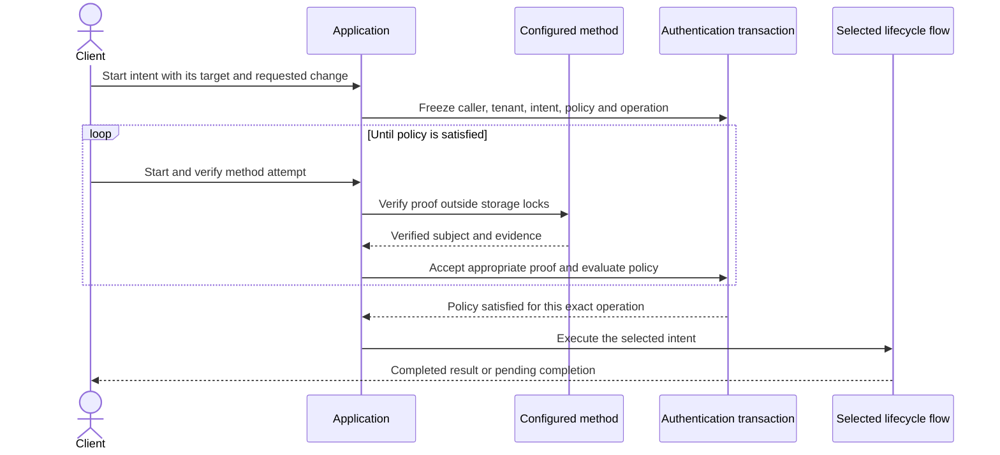
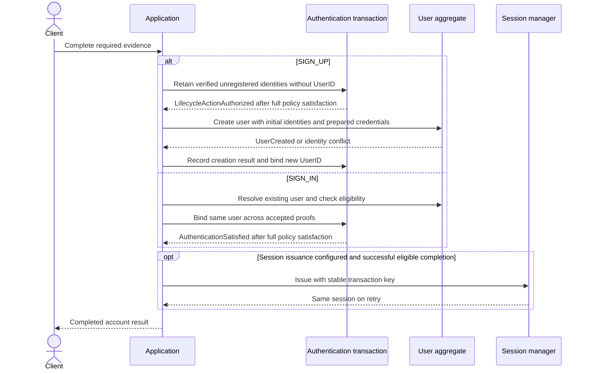
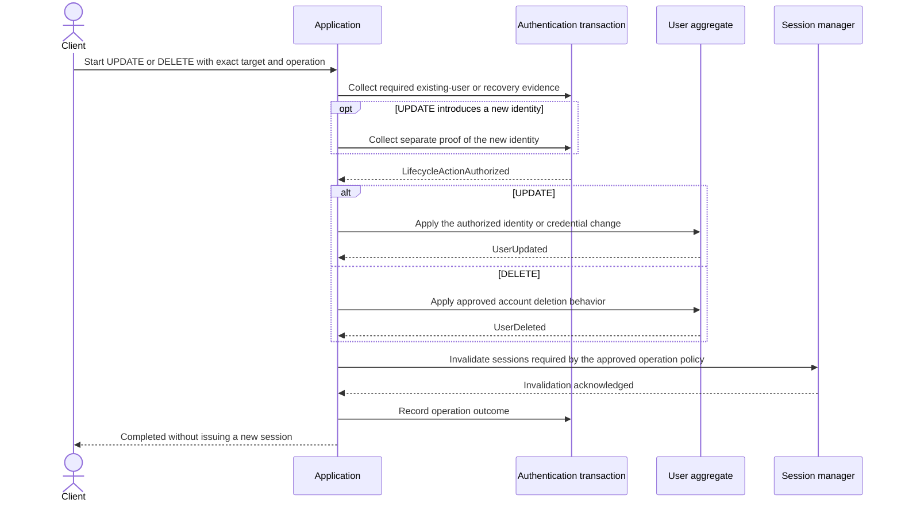
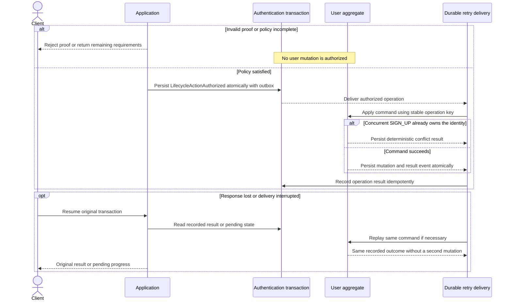

# Account lifecycle intents

Status: historical broad proposal. The owner selected implementation-first review,
one flow at a time. Current SIGN_UP behavior is documented in [sign-up.md](sign-up.md).
Do not infer UPDATE or DELETE implementation from this earlier proposal.

The owner selected four closed intents and separate application business flows:
SIGN_UP, SIGN_IN, UPDATE (including reset), and DELETE. All reuse method
attempts, evidence collection, and policy evaluation. This replaces the earlier
proposal to automatically create missing users during authentication.

## Shared proof collection and intent dispatch

The requested change cannot be replaced after proof collection begins. Proof of
an existing account and proof of a proposed new identity are distinct roles.
For example, possession of a new email does not authorize changing someone
else's account. Raw passwords and tokens never enter evidence, public progress,
or event snapshots. Credential preparation produces a protected enrollment input,
not authentication evidence.

## SIGN_UP and SIGN_IN

SIGN_UP is new-account-only. An identity already owned by another account is a
conflict, not an implicit sign-in or merge. A verified arbitrary UserID cannot
create a user. SIGN_IN rejects missing users and never enrolls credentials.
Password enrollment is distinct from comparing an existing password hash.

## UPDATE and DELETE

Recovery may begin without a signed-in caller but must prove the existing target
user through the configured recovery policy. A new credential is never accepted
as proof of the old account. Profile-field support and deletion semantics remain
open below. No success response precedes required session invalidation.

## Failure, concurrency, and recovery

Proof rejection is not account absence. Storage failures are not registration
signals. Duplicate or out-of-order events cannot apply an operation twice or
change its payload. Poison events retain a failed/pending outcome for inspection;
they never authorize a replacement operation. An expired or canceled transaction
cannot authorize a new action. Once an action is durably authorized and dispatched,
recovery reconciles its committed outcome rather than pretending cancellation
rolled it back. Issuance remains subject to its existing recovery deadline.

## Proposed aggregate roots

| Root | Purpose | Identity and lock | Owned state and immediate invariants |
| --- | --- | --- | --- |
| Authentication transaction | Authorize one exact lifecycle operation through collected proof. | TransactionID, existing root lock. | Immutable target/change, policy snapshot, bounded attempts, proofs and outcome. Each proof has its intended role and one accepted operation cannot change. |
| User | Protect one user's authentication account. | UserID, user root lock for changes. SIGN_UP also enforces unique issuer/subject. | Bounded identities and credentials, lifecycle state, operation result receipts. Identity ownership and credential changes commit through one user write repository. Proposed configurable bound: 16 identities and 16 credentials per user. |
| Session | Control the validity of an issued authentication credential. | Existing host session manager and its stable issuance key. | Session/token state remains outside User and Transaction. Invalidation is acknowledged before UPDATE/DELETE reports completion where required. |

Identity and credential writes go through User commands and its repository,
including writes currently exposed by the standalone identity repository.
Lookup ports can remain available for method verification. User operation receipts
are technical idempotency records accessed by key, not an unbounded collection
loaded with the root. Retention must cover replay of every corresponding event.
No root locks span provider calls, session calls, or mutations of another root.

## Commands, facts, and cross-root routes

| Source fact | Next command | Idempotency and ordering |
| --- | --- | --- |
| Transaction `LifecycleActionAuthorized` | User `Create`, `Update`, or `Delete` | TransactionID plus immutable operation digest. Recheck ownership and eligibility at mutation time. |
| User `UserCreated`, `UserUpdated`, `UserDeleted`, or recorded rejection | Transaction `RecordLifecycleOutcome` | Same operation key and UserID. Cannot complete a different action. |
| Recorded successful result requiring session invalidation | Session manager invalidation command | Stable operation key. Retry or reconcile ambiguous outcomes before completion. |
| Recorded SIGN_UP result or `AuthenticationSatisfied` | Optional session issuance | Existing transaction-key issuance contract. |
| Final action result and required external acknowledgements | Transaction `Complete` | Same durable operation result. Duplicate completion is a no-op. |

Local commands may be attempted synchronously for an immediate response, but the
durable event route recovers interrupted cross-root work. Pending completion is
visible until the account outcome and required external effects are recorded.
Production publication uses the project's Vibox boundary through domain ports;
the demo needs an explicit in-memory relay and remains non-durable. This introduces
new user events and consumers beyond the current transaction-only event contract.
There is no multi-root transaction exception in this proposal.

## Decisions requiring owner review

1. SIGN_UP means new-account-only, with conflicts rejected. SIGN_IN never creates.
2. UPDATE binds evidence to a concrete change and separates target-account proof
   from proof of a newly linked identity. Proposed initial scope: identities and
   credentials, excluding arbitrary host profile fields.
3. DELETE needs a choice: reversible disable/tombstone or permanent removal.
   Identity reuse, retained audit/idempotency facts, tenant scope, and session
   invalidation must follow that choice. Users and identities are currently global,
   so deleting a global user must require explicit host authorization beyond
   ordinary access to one tenant.
4. Proposed session behavior: SIGN_UP/SIGN_IN preserve configured optional
   issuance. UPDATE/DELETE issue no new session. Reset and deletion invalidate
   existing sessions before reporting success. Current SessionManager lacks
   user-wide invalidation and must gain that capability.
5. Approve the User ownership boundary and bounded enrollment collections above,
   plus durable cross-root completion with visible pending progress.
6. Initial user status and enrollment eligibility remain host-configured facts;
   the service owns the creation command and writes. Concrete password hashing
   and provider enrollment adapters require explicit contracts and verification.

## Existing-system disposition

Preserve method attempts, evidence scoping, caller/tenant guards, pure policy
requirements, rollback, and idempotent session issuance. Replace unconditional
existing-user resolution and generic finalization with intent-specific behavior.
This proposal supersedes `authentication-user-creation.md` if approved. No new
feature spec or production code has been changed before this review.
