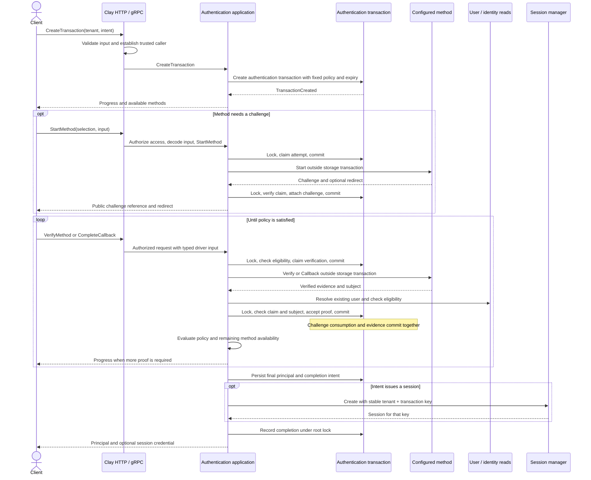
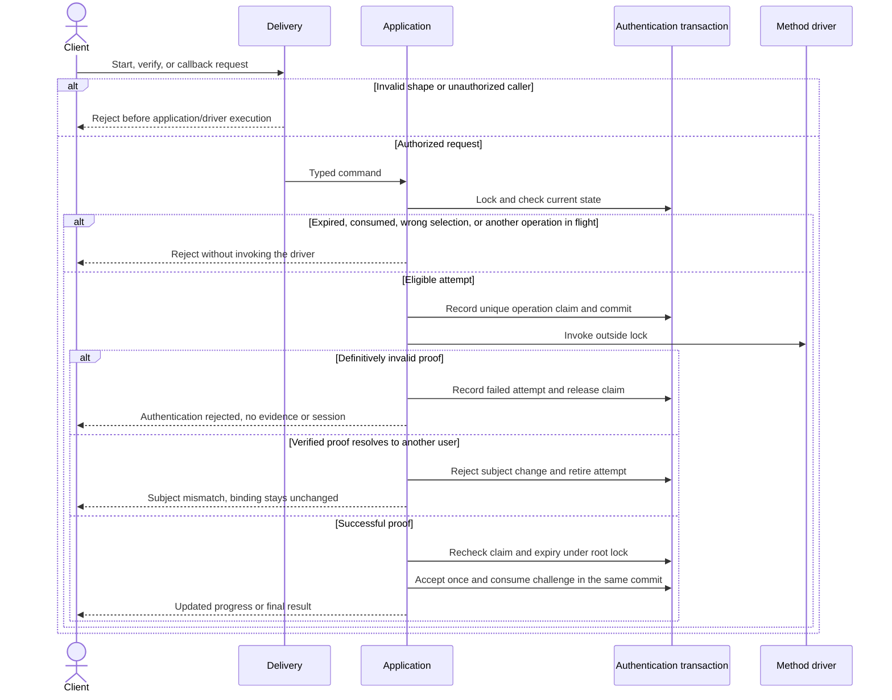
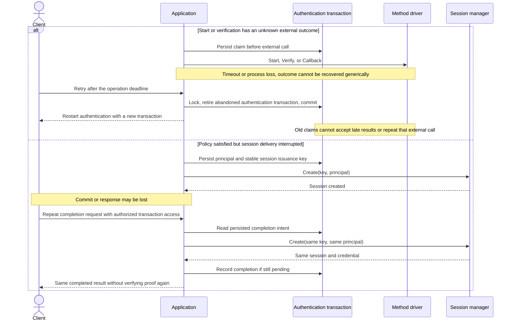

# Authentication flows: first runnable implementation

Method lifecycle is superseded by the approved [pending-attempt model](authentication-method-attempts.md): Start is mandatory, Verify/Callback require its attempt ID, and state transitions emit events atomically.

Status: **Approved by the owner on 2026-09-23.**

## Approval scope

The owner approved this event-storming model on 2026-09-23 and asked to keep
current logic. Implement the existing-user flows below and preserve tenant IDs
in the current API routes and application contracts. Registration, identity
linking, and host-derived tenant routing remain future work. This approval also
covers root-owned challenges and the idempotent session issuance contract.

## Scope for first testing

Implement all five existing RPCs through the generated Clay descriptor and the
`domain/application.Authentication` interface. Exercise real delivery and
application code together using HTTP tests with fake repositories and drivers.
The existing hand-assembled policy demo becomes an actual use-case test.

The first slice authenticates **existing users**. Host configuration determines
whether an intent starts anonymously or requires an authenticated user, and
whether completion returns only a principal or also issues a session. Intent
names remain arbitrary strings. Unknown identities fail; signup and identity
linking are not implicitly implemented as authentication.

Actors: client, host delivery adapter, application service, authentication
transaction, method driver, host user/identity storage, host session manager.
Tests use seeded users and fake methods; no live providers or database are needed.

## Happy path

`GetTransaction` is read-only: authorize access, read the authentication transaction, evaluate its
fixed policy, and return current progress. It never starts a driver, repairs state,
or returns a session credential. Callback method selection always comes from the
stored challenge; callback payload fields cannot override it.

## Rejection and concurrency

User eligibility is supplied by a required host rule because user status values
are not yet defined. Unknown users and identities fail closed. The demo rule
accepts only its explicitly seeded users. Proofs must match tenant, method,
provider, requirement scope, and the transaction's user binding.

## Failure and recovery

An in-flight retry returns a conflict until the claim deadline. Abandoned
non-idempotent operations require a fresh authentication transaction; they are never retried blindly.
Definitive rejection may permit another attempt within configured limits.
Cancellation before dispatch releases a claim when possible; cancellation after
dispatch follows the unknown-outcome route. Absolute authentication transaction expiry bounds all
continuation and result retrieval, including session recovery. `GetTransaction`
does not trigger recovery. No background worker is needed for the first test slice.

Session issuance requires a strengthened gateway contract: the same key and
principal return the same session/credential during the authentication transaction's recovery window;
reuse of a key with different principal data is rejected. The gateway owns that
idempotency guarantee, including any backing session persistence. Raw session
tokens are not added to the transaction repository.

## Aggregate boundaries

| Root / boundary | Purpose | Owned state and invariants | Write/lock boundary |
| --- | --- | --- | --- |
| Authentication transaction | Protect one authentication transaction's progress. | Fixed tenant, intent, policy, caller association, expiry, user binding, evidence, bounded challenges, one operation claim, final principal, completion intent. A consumed challenge and its accepted evidence are inseparable. | Existing roots use `Transaction.Get(..., ForUpdate())` inside `TransactionManager.Do`; one transaction repository saves root and owned attempts. |
| User | Represent an existing canonical subject. | Existing user record; no lifecycle changes in this slice. | Read through the user port and apply the host eligibility rule. |
| Identity | Identify the existing owner of an issuer/subject pair. | Existing unique issuer/subject mapping; no creation, reassignment, or linking in this slice. | Read-only resolution through the identity port. |
| Session, behind the host gateway | Represent the credential issued for a completed principal. | Session validity and idempotent issuance; independent of authentication storage. | Session manager call after committing the transaction's completion intent; no shared or distributed lock. |

Transaction creation uses a generated ID with uniqueness enforced by its storage
adapter. Tenant plus transaction ID is the canonical lock identity. Challenges
are owned attempts, even when selected by their own ID; every attempt mutation
goes through its transaction root. Host-configured finite limits bound policy
size, challenge count/state size, attempt count, and transaction/claim lifetime.
There is no unbounded attempt history inside this aggregate.

The transaction stores stable user/identity references and verified facts; it
does not own or mutate user or identity roots. Cross-store revocation cannot be
made atomic with proof acceptance by this interface. User eligibility is checked
before binding and finalization; continuous revocation is outside this first slice.

## Commands and state-change facts

| Entry point | Root commands / facts | Next action |
| --- | --- | --- |
| `CreateTransaction` | Create → `TransactionCreated` | Evaluate initial method availability. |
| `StartMethod` | Claim attempt → `MethodAttemptStarted`; attach challenge → `ChallengeCreated` | Return public challenge/redirect after commit. |
| `VerifyMethod`, `CompleteCallback` | Claim verification; accept → `EvidenceAccepted`; reject → `MethodAttemptRejected` | Re-evaluate policy; finalize only with a bound eligible user. |
| Internal finalization | Prepare → `AuthenticationSatisfied`; complete → `AuthenticationCompleted` | For session-enabled intents, call the session gateway using committed issuance identity. |
| Mutating retry after an abandoned claim | Abandon → `AuthenticationAbandoned` | Client starts a new authentication transaction. |
| `GetTransaction` | None | Read-only progress. |

These facts describe root transitions for the review. They do not introduce
broker publication, consumers, or an outbox. There are no event-driven writes to
User or Identity. The external session action is recoverable from the committed
transaction completion intent and its stable idempotency key; no cross-root
atomic commit is claimed.

## Decisions included in this proposal

1. Support all five API operations for existing users, including direct proofs,
   challenges, callbacks, MFA, and principal-only or session-bearing completion.
   Signup and linking fail as unsupported intent behavior unless separately designed.
2. Own challenges within the authentication transaction's persistence boundary.
   Application code will no longer independently write `repository.Challenge`;
   revise internal storage contracts and regenerate mocks accordingly.
3. Pin a policy snapshot for each authentication transaction so configuration changes cannot rewrite
   an in-progress authentication transaction's proof requirements.
4. Require host-provided access checks, user eligibility, and driver-input decoding.
   Callback decoding cannot choose the execution method; the stored challenge does.
   Tests inject these hooks; the service has no default allow-all authorization.
5. Serialize operations with bounded claims, fail closed on unknown driver outcomes,
   and strengthen session creation with a stable issuance key for completion retries.
6. Deliver an HTTP integration-test path through the real Clay adapter plus
   application tests with generated mocks. This slice does not add a standalone
   public server, live provider drivers, Redis, or PostgreSQL.

## Approval

The six decisions, diagrams, and root boundaries above are approved. Implement
without changing the public `authorization.v1` RPC names, routes, or response shapes.
