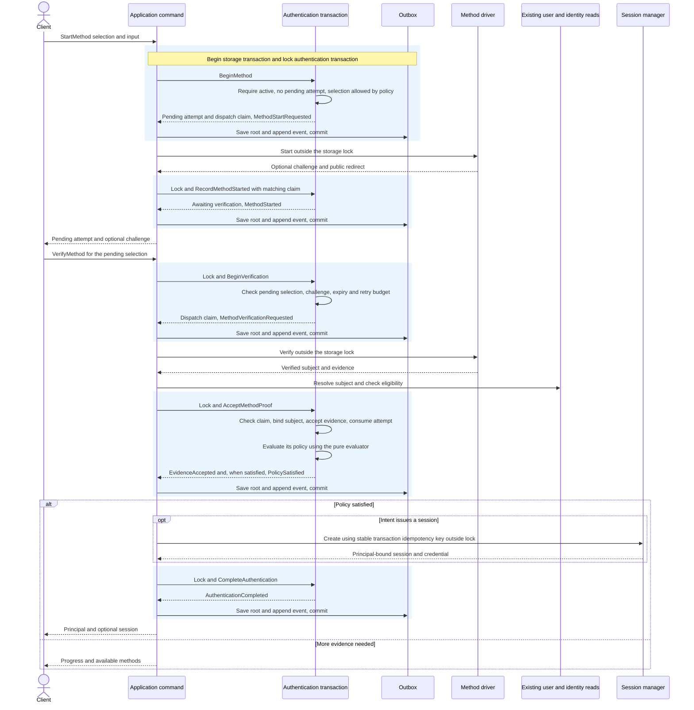
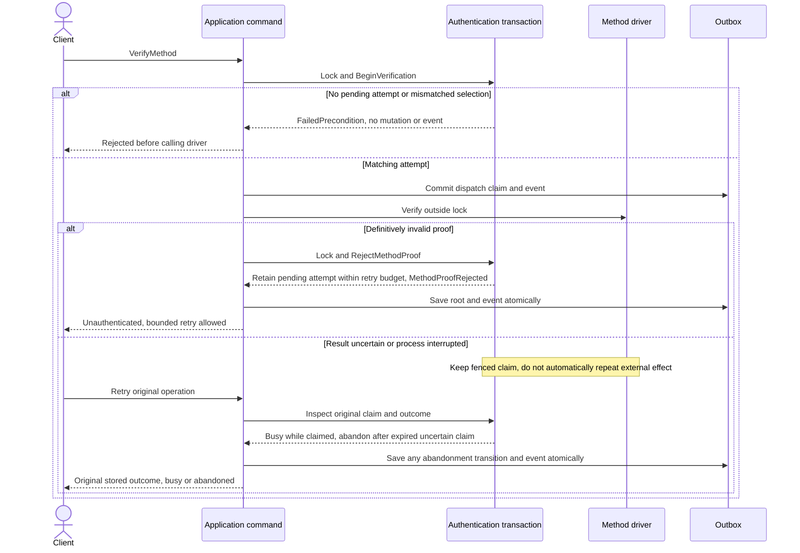

# Authentication transactions with pending method attempts

Status: Approved by the owner on 2026-09-23.
The owner has approved the direction: transaction-owned guards, mandatory start,
matching pending verification, and evidence evaluation by the transaction.
The owner confirmed synchronous finalization: Verify returns the principal and
optional session when the policy is satisfied. The owner approved the attempt-identity contract and the explicitly ephemeral
in-memory publication exception.

## Aggregate boundaries

| Root | Purpose | Identity and owned state | Consistency boundary |
| --- | --- | --- | --- |
| Authentication transaction | Establish one authenticated subject for a fixed tenant and intent policy. | Tenant + transaction ID, policy snapshot, one pending attempt, optional challenge, bounded evidence, operation claim, outcome, version. | Lock the transaction before every mutation, save its state and emitted events atomically. |
| User | Represent the canonical account. | Existing user ID and account status. | Read-only in this refactor. Registration is a separate workflow. |
| Identity | Associate a verified issuer and subject with a user. | Existing identity ID and unique issuer/subject pair. | Read-only in this refactor. |
| Session | Represent an issued authenticated session. | Managed by the host session driver. | Issued outside the authentication transaction's storage lock with its existing stable idempotency key. |

A pending method attempt belongs to the authentication transaction, not a new
aggregate. It has no independent repository. A challenge is optional private
state owned by that attempt. An operation claim only fences an in-flight driver
call, while the pending attempt survives between Start and Verify requests.

## Start and verify

`CompleteCallback` follows the same verification transitions. Its selection
comes from the pending attempt and stored challenge, never from callback input.
Availability checks and proof verification remain driver calls outside locks.
The aggregate validates the supplied facts and current state again on commit.

## Rejection and recovery

Successful retries reuse the recorded attempt outcome and do not call the driver
again. Completed attempts retain bounded receipt metadata until transaction expiry.
An attempt identifier returned by Start and required by Verify fences stale
retries when the same selection is started again. Duplicate Start for the same
still-pending selection returns its stored start outcome, without a second call.
Missing users and identities remain NotFound. They do not implicitly register
accounts. Terminal rejection retires the pending attempt and emits its transition.

## Commands and events

| Command | Changed state | Aggregate-produced event |
| --- | --- | --- |
| CreateTransaction | New root | TransactionCreated |
| BeginMethod | Pending attempt and start dispatch claim | MethodStartRequested |
| RecordMethodStarted | Optional challenge, ready for verification | MethodStarted |
| BeginVerification | Verification dispatch claim and attempt counter | MethodVerificationRequested |
| RejectMethodProof | Release claim and record rejection, retain or retire attempt | MethodProofRejected |
| AcceptMethodProof | Evidence, bound subject, consumed attempt, policy outcome | EvidenceAccepted and, when satisfied, PolicySatisfied |
| AbandonAttempt | Abandoned root, cleared private challenge state | TransactionAbandoned |
| CompleteAuthentication | Completed root and principal reference | AuthenticationCompleted |

Events carry stable event ID, type, schema version, tenant and transaction ID,
aggregate version, occurrence time, correlation and causation IDs, actor/source,
and immutable before/after snapshots. Creation has a null before snapshot.
Snapshots include lifecycle, pending-attempt identity and selection, challenge
reference and status, evidence metadata, subject binding, policy outcome and
claim metadata. Omit passwords, proof inputs, tokens, caller secrets, private
challenge payloads and driver configuration. Rehydration and no-op retries emit
nothing. Production adapters partition by tenant + transaction ID and deliver at least once.
The in-memory implementation only records events; it has no relay or consumer.

## Completion and publication decisions

1. **Completion response, confirmed by owner:** finalization remains synchronous.
   Start, Verify and Callback are user-action commands. Domain events describe
   their committed state changes and do not schedule the next authentication
   step or finalization. After PolicySatisfied is committed, the same application
   request invokes the idempotent session driver outside the lock, then commits
   CompleteAuthentication and AuthenticationCompleted. No finalization consumer
   or new completion endpoint is introduced. A failed or lost completion response
   is recovered by retrying the same verification, without verifying the proof
   again. GetTransaction remains read-only and token-free.
2. **Atomic publication:** the implementation adds the domain event-publisher port.
   Persistent hosts must supply a Vibox-backed durable adapter sharing their root
   storage transaction. This slice implements the approved ephemeral driver; a
   production adapter and relay require a concrete host storage integration.
3. **Local testing exception, approved:** the in-memory driver uses an atomic
   in-memory outbox with the same commit/rollback behavior. It is not
   restart-durable. This exception applies only to the explicitly ephemeral demo
   and tests, and was approved by the owner for this implementation.
4. **Compatibility:** mandatory Start and attempt-ID matching change the direct
   Verify flow. Update Go/protobuf contracts, generated bindings and all example
   requests together. An attempt ID is required even for methods without challenges.
5. No new registration, credential enrollment, identity linking, or MFA enrollment
   behavior is included. Those require their own transitions and event routes.

## Approval

Synchronous completion, attempt identity, and the explicitly ephemeral test
publication exception are approved. Events are
notifications of committed user-action transitions, not asynchronous orchestration
of this authentication flow.
