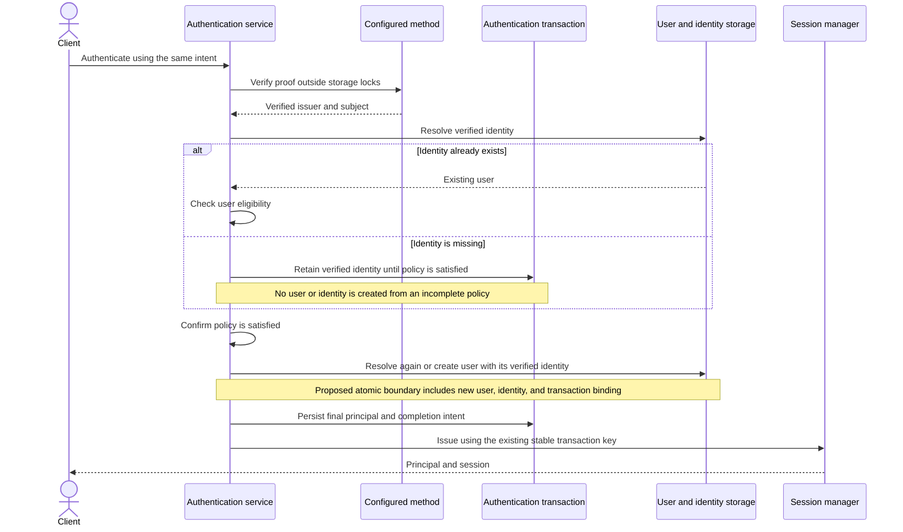
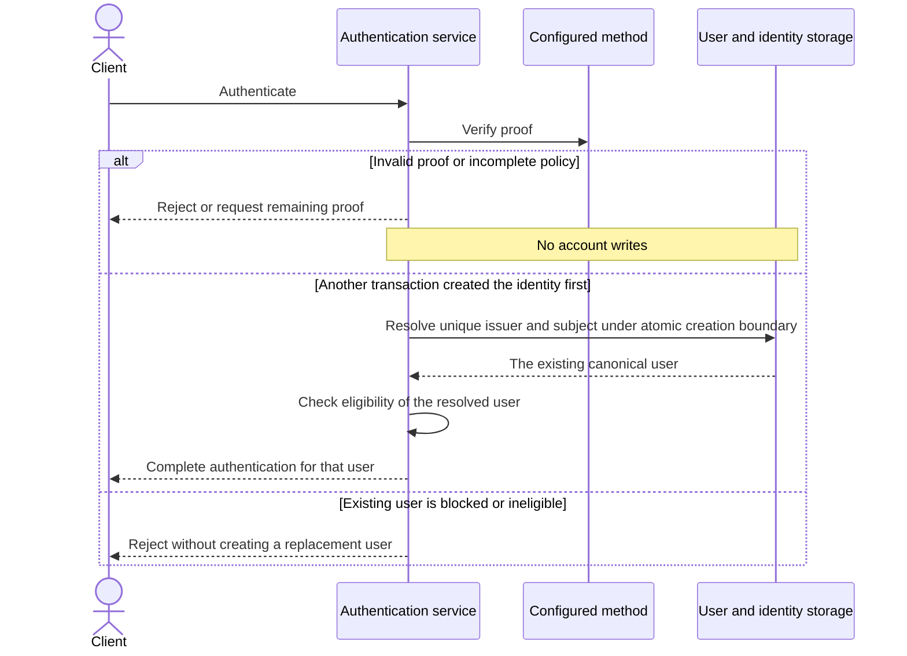
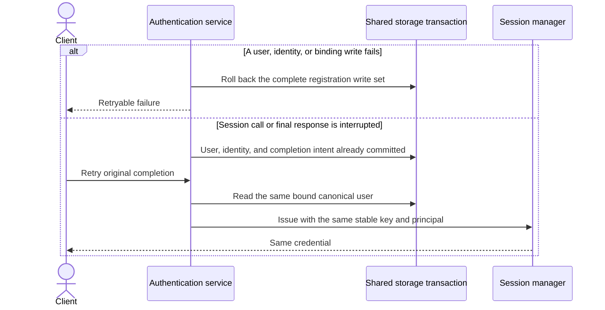

# Authentication with user creation when missing

Status: proposed. The owner selected one flow that creates the user if missing.
This review extends the approved existing-user-only authentication model.

## Happy path

## Rejection and concurrent first authentication

## Failure and recovery

## Boundaries

| Root | Purpose | Creation/write boundary |
| --- | --- | --- |
| Authentication transaction | Protect one proof-collection and completion attempt. | Existing root lock, bounded verified identity data, immutable policy and caller binding. |
| User | Represent one canonical subject. | Create only after policy satisfaction; never upsert over a blocked or existing user's data. |
| Identity | Give a verified issuer/subject pair exactly one owner. | Unique issuer/subject and identity ID; never reassign or merge by email. |
| Session | Represent the issued credential. | Existing idempotent host session manager, outside storage locks. |

Commands and state-change facts: accept proof → `EvidenceAccepted`; create a
missing canonical subject → `UserCreated`; create the initial verified identity
→ `IdentityCreated`; bind the final subject → `AuthenticationSatisfied`;
complete issuance → `AuthenticationCompleted`. Resolving an existing user is a
read and emits no creation fact.

## Decisions for approval

1. One explicitly configured intent resolves or creates a user. Intent names
   themselves remain arbitrary and do not select behavior. No separate sign-up
   endpoint and no implicit user creation in existing-only configurations.
2. Only a driver-verified issuer/subject may create a user. An arbitrary returned
   UserID cannot create one. No account writes occur before policy satisfaction.
3. Concurrent creation and repeated completion resolve to the same user. Existing
   identity matches authenticate that user; blocked/ineligible users stay rejected.
   The host owns initial user attributes and eligibility; the engine does not
   invent a universal initial status or tenant-membership rule.
4. The demo uses a mock primary identity proof for this flow. Its hardcoded TOTP
   factor is removed from this demo policy because newly created users have no
   enrollment. Production MFA enrollment and password storage are outside this
   slice. Existing MFA engine behavior remains available to other policies.
5. **Proposed narrow architecture exception:** creation of a User, its initial
   Identity, and the authentication transaction's binding commit together in the
   shared in-memory transaction manager. Lock the authentication transaction first;
   serialize creation by unique issuer/subject, and re-resolve a winning existing
   identity. No provider or session calls occur while these locks are held.
   This prevents partially committed registration or a completion bound to a
   losing concurrent user ID. Any write failure rolls back the complete write set.
6. This example extension proposes no durable event broker/outbox, extending the
   initial model's exception for this test slice. Facts above describe the atomic
   transitions, not published messages. Owner approval is required for this
   multi-root/no-outbox exception. Before production persistence, review it against
   a host-owned atomic registration port or durable event-driven orchestration.

The existing approved model does not cover decisions 2–6. No application/domain
registration changes have been made pending review. The independent in-memory
user-mock correction can be used now for seeded existing-user tests.
