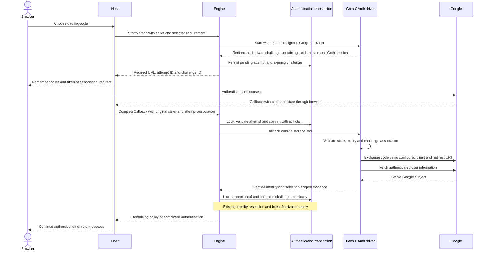
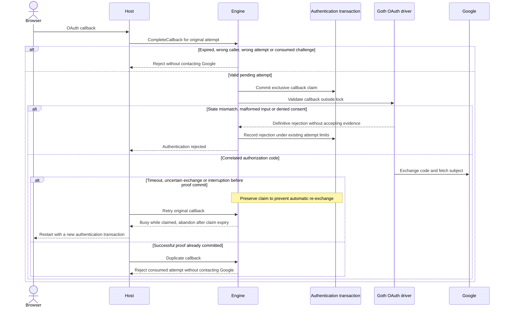

# Google OAuth through Goth

Status: Approved by the owner on 2026-09-24.

## Successful authentication

## Rejection and recovery

Consent cancellation does not create evidence. The host can offer a fresh
authentication transaction. A lost success response can be inspected through
GetTransaction, but this feature does not promise recovery of a raw session token.

## Aggregate boundaries

| Existing root | Purpose | Owned state and boundary |
| --- | --- | --- |
| Authentication transaction | Establish one subject for a fixed tenant and policy. | Tenant + transaction ID identifies the lock and repository root. Owns bounded pending attempt, private challenge, callback claim, evidence and outcome. Successful proof and challenge consumption commit together. |
| User | Represent the canonical account. | Existing sign-in/sign-up behavior remains responsible for account eligibility and creation. The driver never writes users. |
| Identity | Associate an issuer and subject with a user. | Existing unique issuer/subject resolution and sign-up conflict checks apply. The driver returns proof only. |
| Session | Represent an authenticated session. | Existing host session manager owns issuance. Google access tokens are not engine session credentials. |

The OAuth challenge has no independent write lifecycle or repository. It is
bounded private state belonging to the transaction, with expiry capped by the
transaction deadline. No new aggregate, migration, event consumer or projection
is introduced. Existing sign-up boundaries and exceptions remain unchanged.

## Commands and events

| Command | Existing transaction events |
| --- | --- |
| StartMethod | MethodStartRequested, MethodStarted |
| CompleteCallback dispatch | MethodVerificationRequested |
| Reject proof | MethodProofRejected |
| Accept proof | EvidenceAccepted, optionally PolicySatisfied |
| Abandon uncertain attempt | TransactionAbandoned |
| Existing intent finalization | Existing UserRegistered and AuthenticationCompleted where applicable |

Root mutations and event publication share a storage transaction. Events omit
codes, tokens, OAuth state and serialized Goth sessions. There are no new
cross-aggregate event routes. Provider requests are synchronous external effects
outside the root lock. Authorization-code exchange has no application-controlled
idempotency key, so uncertain exchanges must not be automatically repeated.

## Observable decisions proposed for approval

- Add `driver/method/goth` implementing method `oauth`, initially supporting
  provider `google`. Configure instances per tenant with host-supplied client
  credentials and a fixed registered callback URL. Avoid Goth's global registry
  and Gothic cookie sessions.
- Use Google's confidential web-server authorization-code flow through Goth.
  Request identity scopes, use cryptographically random per-attempt state, and
  compare callback state before exchanging the code. Host callback routing must
  recover the original caller/tenant/transaction/attempt association. Untrusted
  callback parameters cannot choose provider configuration or redirect URI.
- Return identity kind `oauth`, issuer `https://accounts.google.com`, and the
  authenticated Google subject. Email never determines account ownership or
  triggers linking. Support existing sign-in and sign-up policies.
- Accept typed start and callback inputs. Verify may use the same proof path
  only with an existing matching challenge. Reject missing or unexpected input,
  empty subjects, expired challenges and mismatched selections.
- Keep provider tokens transient and sanitize provider errors before tracing or
  returning them. Use bounded provider request timeouts. Do not introduce token
  refresh, account linking, other providers, callback HTTP routes or UI.
- Restore the already-approved claim/dispatch/commit boundary for OAuth callback
  execution and any shared verification path used by this driver. Preserve
  exclusive claims on ambiguous provider outcomes and reject consumed attempts.
  This is a prerequisite for safely integrating real network calls.

## Existing implementation constraint

`application/service/authentication-service/complete_callback.go` currently calls
the driver inside `txManager.Do`. Its operation claim rolls back on callback
failure. This differs from the approved pending-attempt model's external-call
and recovery boundaries. Driver-only implementation cannot fix that mismatch.
The proposal includes the targeted application correction and integration tests,
without changing the account lifecycle or adding a new retry API.

## Protocol references

- [Goth Google provider](https://github.com/markbates/goth/blob/master/providers/google/google.go)
- [Goth Google session and code exchange](https://github.com/markbates/goth/blob/master/providers/google/session.go)
- [Google web-server OAuth flow](https://developers.google.com/identity/protocols/oauth2/web-server)

Goth's inspected Google session exchanges the code without a PKCE verifier.
This proposal uses the confidential-client flow. A PKCE requirement would need
an explicit compatible extension to the exchange implementation.

## Approval

The owner approved the Google flow and targeted callback boundary correction on
2026-09-24. Implementation is authorized.
