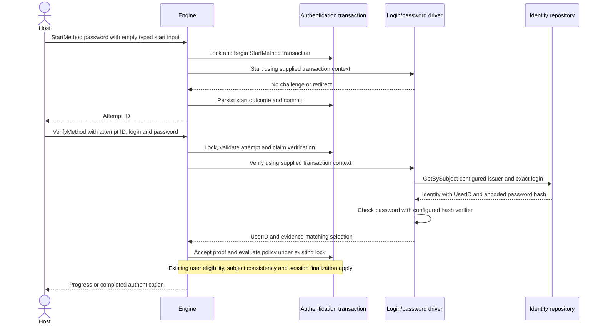
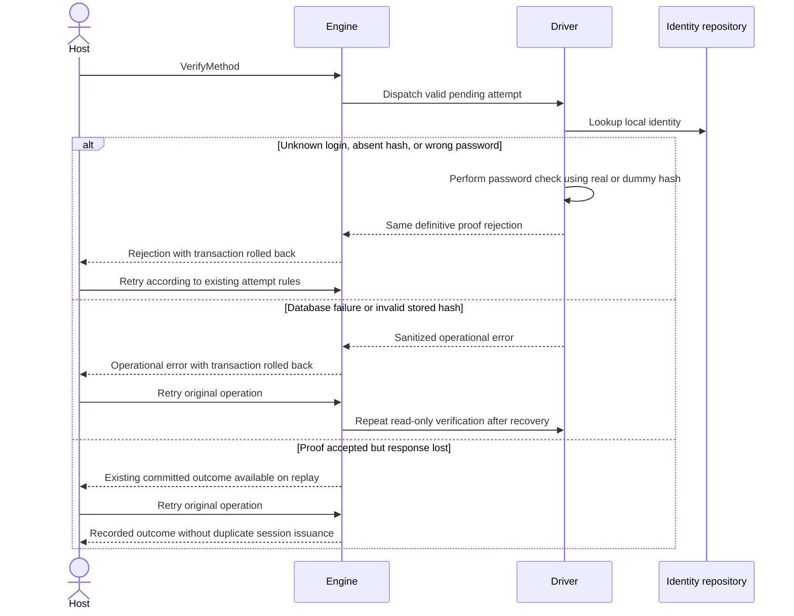

# Login/password method driver

Status: Approved by the owner on 2026-09-24. Implemented; see
[host wiring](../../driver/method/logpass/README.md) and
[verification results](../../spec/004-login-password/plan.md).

Add `driver/method/logpass`, registered as method `password` without a provider.
Verify existing local identities through the host-supplied identity repository.
The current identity model has no password hash, so this proposal adds an optional
encoded `PasswordHash` to Identity. Password enrollment and reset remain outside
this slice. The host provisions hashes and supplies a compatible password verifier.

## Successful authentication

## Failure and recovery

## Aggregate boundaries

| Root | Purpose | Owned state and change |
| --- | --- | --- |
| Identity | Associate one issuer/subject pair with a canonical user. | Owns one optional encoded password hash alongside its existing immutable user link. Hash provisioning uses identity creation, not a separate credential repository. |
| Authentication transaction | Establish one authenticated subject under a fixed policy. | Existing bounded attempts, proof acceptance, locking and events remain unchanged. |
| User | Represent the canonical account. | Read by existing engine eligibility checks, never changed by the driver. |
| Session | Represent an issued authenticated session. | Existing issuance after policy satisfaction remains unchanged. |

The identity creation key remains `(Issuer, Subject)`, with a unique IdentityID.
The credential is bounded, is read with its owning identity, and cannot authenticate
a different UserID. No independent credential write lifecycle is introduced.
Existing identity deletion retains its root-lock requirement. Verification makes
no database writes or explicit root locks. The current engine invokes methods
inside its existing storage transaction, so that transaction remains held during
password verification. This feature does not change engine locking. Existing proof
acceptance semantics apply if an identity is deleted after the credential read.
Credential rotation and stronger revocation guarantees require a later design.

## Commands, events and routes

Use existing `StartMethod` and `VerifyMethod` commands and existing
`MethodStartRequested`, `MethodStarted`, `MethodVerificationRequested`,
`MethodProofRejected`, `EvidenceAccepted`, `PolicySatisfied`,
`TransactionAbandoned` and `AuthenticationCompleted` events as applicable.
No new command, event, consumer, or cross-aggregate event route is introduced.
Passwords and hashes must never enter evidence, events, public responses, logs,
or recorded errors.

## Approved decisions

1. Add the optional encoded password hash to Identity and preserve it in the
   existing in-memory identity adapter. Production database mapping remains the
   host's responsibility, consistent with the existing repository port.
2. The driver defaults to issuer `local` and bcrypt at `bcrypt.DefaultCost`;
   hosts can override issuer and password verification. Lookup uses the
   login exactly as supplied, with no case folding, trimming, or email merging.
   Tenant isolation follows host-configured repositories and issuer namespaces.
3. The driver generates a bcrypt dummy hash for unknown identities by default.
   A custom verifier requires a host-supplied dummy hash with matching algorithm
   and cost. Enforce bounded input and hash work. No plaintext
   credential storage, custom password hashing, or automatic hash upgrade.
4. Enable this driver for SIGN_IN only. Start requires an empty typed input,
   Verify requires typed login/password input, and no challenge is used.
   Reject unsupported selections, malformed input and mismatched bound users.
5. Return the verified existing UserID. The engine continues to own user
   eligibility, policy evaluation and session issuance. Host rate limiting
   supplements existing per-transaction attempt bounds.

Implementation and tests are recorded in `spec/004-login-password`. Repository-wide
verification limitations are listed in its plan.
