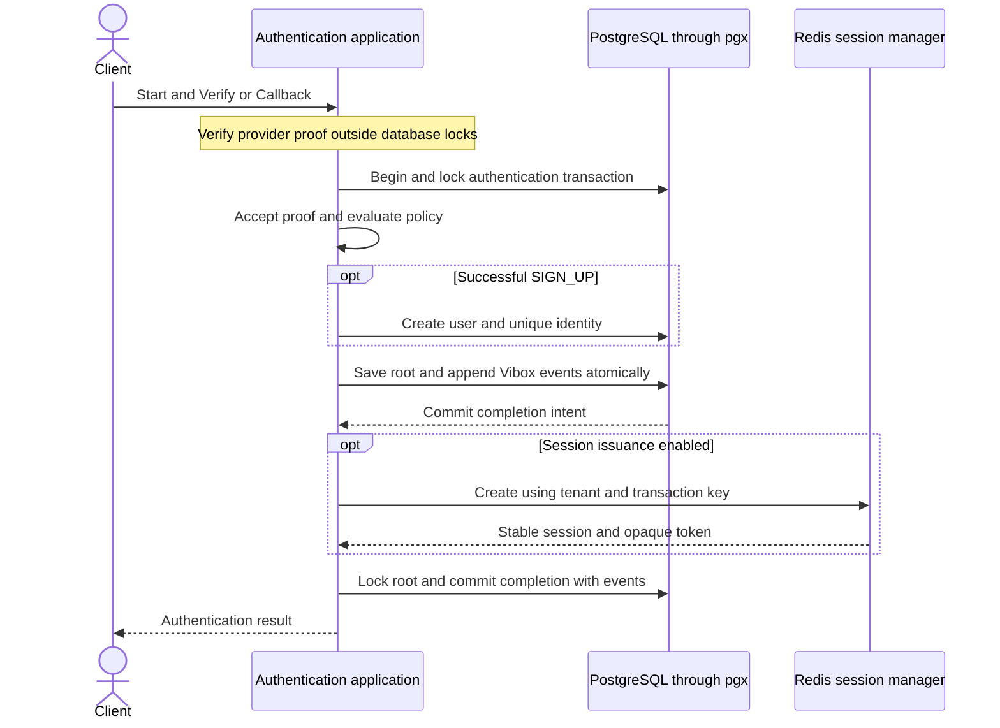
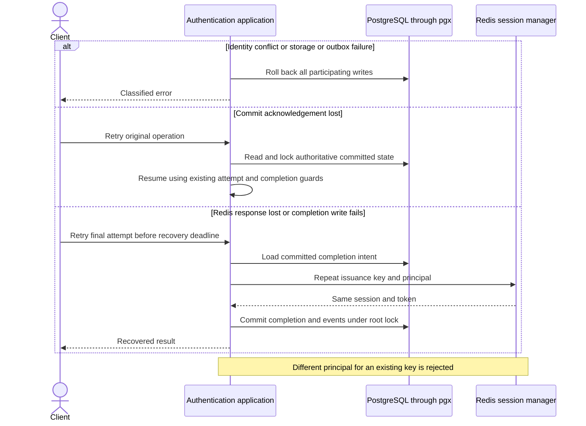
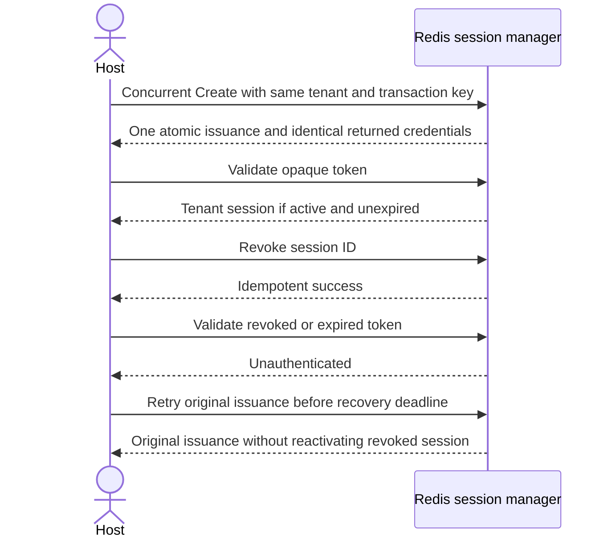

# PostgreSQL and Redis drivers

Status: Approved by the owner in the implementation task on 2026-09-25.

Add pgx PostgreSQL adapters for every storage dependency in `Dependencies`:
Transactions, Users, Identities, TransactionManager, and Events. Events use the
required Vibox durable outbox in the same PostgreSQL transaction. Add Goose
migrations and host wiring documentation. Host configuration continues to own
policies, access, eligibility, and authentication methods.

Interpret “session store redis” as a Redis-backed tenant `SessionManager`, matching
the existing in-memory driver's Create, Validate, and Revoke surface. It owns
logical sessions, opaque credentials, and issuance recovery. A separate generic
`repository.Session` adapter is not required by engine dependencies.

## Happy path

## Failure and recovery

## Session lifecycle

## Aggregate boundaries

| Root | Purpose and owned state | Identity and concurrency |
| --- | --- | --- |
| Authentication transaction | Collect and finalize one authentication flow, owning bounded attempts, challenges, claims, evidence, receipts, policy/settings snapshots, and completion intent. | Tenant and transaction ID, exact owner-key filtering, root row locked before mutation until commit. |
| User | Represent one canonical subject, owning status and creation time. | Global user ID, unique creation, locked Get before Update. |
| Identity | Assign one stable provider subject to one user, owning kind, issuer, subject, and optional password hash. | Global identity ID and unique issuer/subject, locked Get before Delete. |
| Session | Represent one tenant login, owning principal, credential lookup, expiry, revocation, and bounded issuance recovery state. | Tenant and session ID, unique issuance by tenant and transaction key, atomic Redis operations. |

No new business aggregate or cross-aggregate event consumer is introduced.
The outbox is technical durable publication state, not a business root. Each
command appends a bounded set of existing transaction events without loading history.
Transactions reference user IDs, identities reference user IDs, and sessions copy
the final principal. Redis does not join a PostgreSQL transaction.

## Commands, events, and external effects

- Preserve existing Start, Verify, Callback, and completion commands and their
  transaction-owned events, including MethodStarted, EvidenceAccepted,
  UserRegistered, PolicySatisfied, and AuthenticationCompleted.
- Persist envelopes with their stable IDs, aggregate versions, and correlation
  metadata. Preserve existing snapshot redaction and exclude unpublished events
  from persisted transaction snapshots.
- No event drives authentication completion. Vibox relay/broker configuration is
  host-owned, with at-least-once delivery and idempotent consumers. This change
  supplies durable publication storage and wiring guidance, not a new broker.
- Redis issuance runs after committed completion intent and outside root locks.
  Retain issuance recovery data until both the session expiry and RecoverUntil
  have passed. An issuance retry must never extend expiry or reverse revocation.
- Redis persistence, replication, and eviction settings remain host deployment
  responsibilities. Recovery guarantees require retention of acknowledged data.

## Atomic sign-up exception for approval

Preserve the existing synchronous SIGN_UP boundary: lock the authentication
transaction, create User, create Identity, save transaction, append events, commit
once. No existing user or identity is mutated. Unique identity creation serializes
competing registrations, and any failure rolls back the entire write set.

The immediate invariant is that failed registration leaves no orphan account or
identity and no committed authentication binding. Eventual account creation would
introduce pending-account and compensation behavior beyond the current contract.
Lock order remains transaction first, then creation constraints. Constraint
conflicts reject the losing registration. Database deadlocks and transient failures
roll back and return classified errors without replaying callback side effects.
Owner approval of this document approves this narrow exception for the drivers.
Revisit it if registration introduces additional mutable roots or staged accounts.

## Scope and decisions

- Preserve existing domain contracts and in-memory drivers. Add optional drivers
  under the current `driver/<dependency>/<implementation>` layout.
- Include PostgreSQL migrations and integration verification for rollback, locks,
  immutable fields, snapshot round trips, uniqueness, and atomic event publication.
- Include Redis concurrency, tenant isolation, recovery, expiry, and revocation
  verification. No automatic deployment or destructive database reset.
- The owner approved this boundary map, atomic sign-up exception, and Redis
  SessionManager interpretation. Schema details and implementation documents are
  derived from that approval.
