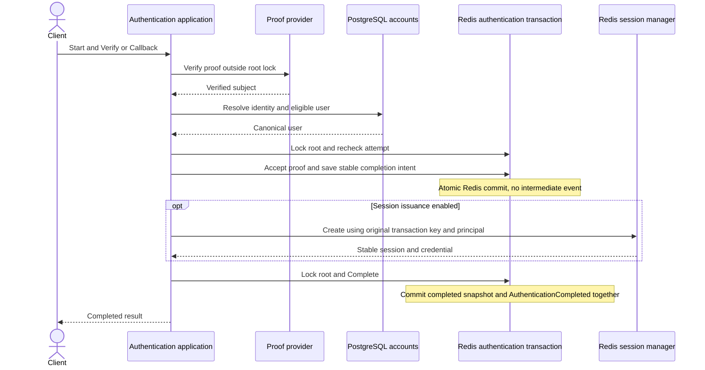
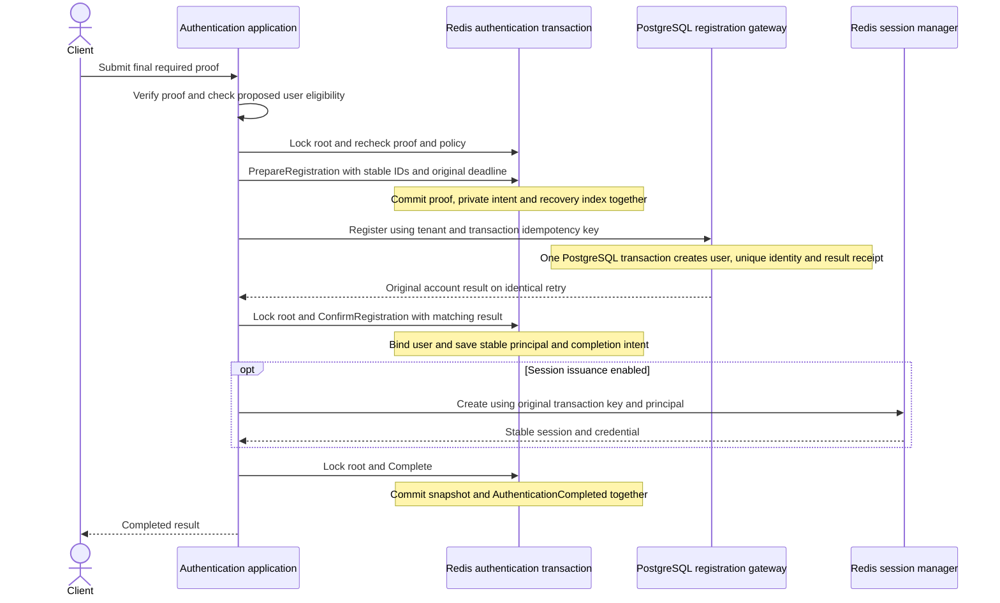
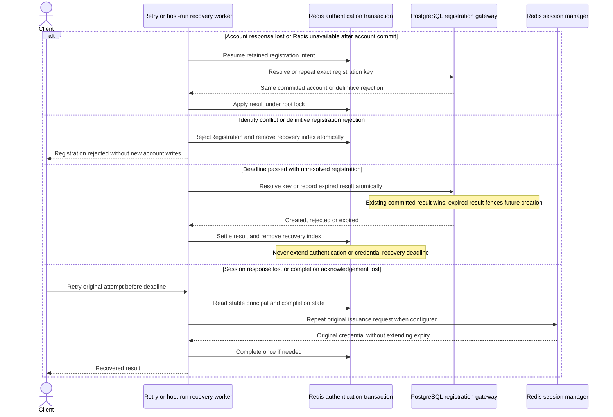
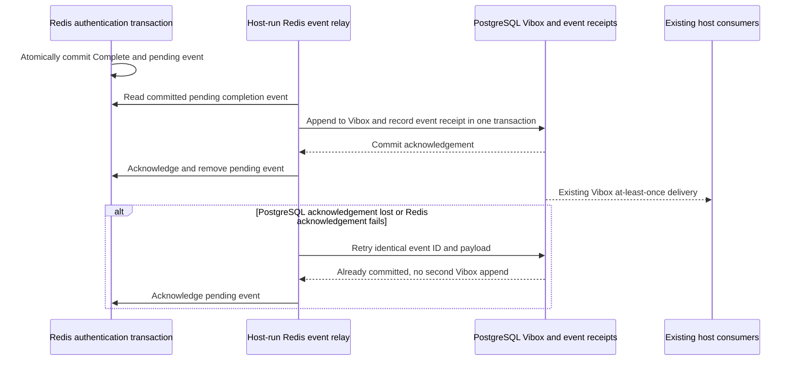

# Authoritative Redis short-lived storage

Status: Authoritative Redis selected by the owner on 2026-09-27. The recovery
model below is proposed for approval before production implementation.

## Aggregate boundaries

| Root | Purpose | Identity and owned state | Consistency boundary |
| --- | --- | --- | --- |
| Authentication transaction | Protect one authentication flow. | Tenant and transaction ID, exact owner filter. Owns bounded challenges, provider state, attempts, claims, receipts, evidence, policy/settings, registration intent and completion intent. Excludes accounts and credentials. | Redis root lock with an ownership token checked at commit. Snapshot, recovery index and completion event append commit atomically. |
| Session | Represent one tenant login. | Tenant and session ID. Owns principal, credential lookup, expiry, revocation and issuance recovery keyed by tenant and transaction ID. | Existing atomic Redis session manager, independent of transaction persistence. |
| User | Represent one canonical subject. | Global user ID, status and creation time. Excludes authentication state. | PostgreSQL. Registration creates a user and its initial identity atomically under the narrow exception below. |
| Identity | Assign a provider subject to one user. | Global identity ID, unique issuer/subject and user reference. | PostgreSQL uniqueness prevents competing registrations from acquiring the same identity. |

Attempts, OAuth state and PKCE verifiers remain transaction-owned state. No
separate mutable challenge root is introduced. Include an optional Redis challenge
read projection and logical session repository alongside the existing token-based
session manager. Policies remain configured by the host. Users and identities
remain in PostgreSQL; Redis is not a cache for authentication transactions.

Registration intent is bounded business state owned by the authentication root.
The PostgreSQL registration receipt is technical idempotency state: it records
one immutable request fingerprint and terminal result. Redis recovery indexes,
pending event entries and PostgreSQL event receipts are technical delivery state.

## SIGN_IN and common completion

Existing PostgreSQL and in-memory configurations remain supported. The Redis
configuration uses staged finalization so external account/session operations
run outside the root lock. An operation failure never rolls back another store
implicitly. No arbitrary transaction callback is automatically replayed.

## SIGN_UP: durable intent, idempotent account creation

A competing registration key for the same identity receives AlreadyExists. A
repeated key with different account data is rejected. IDs, principal timestamps,
proof and deadlines are persisted before their corresponding external effect;
retries cannot change them. Eligibility is checked again before session issuance.

## Failure, expiry and recovery

Pending registration roots are retained until the PostgreSQL outcome is resolved,
including after the authentication deadline. The worker settles account state
only; it does not issue credentials. After the deadline, a committed account
remains usable through a fresh SIGN_IN, but this transaction cannot authenticate.
A timed-out SIGN_UP can therefore leave a complete user/identity pair. There is
no automatic deletion or compensation of a successfully created account.

Unstarted or settled transactions expire at their original ExpiresAt and later
reads return not found. Pending registration recovery has no TTL that could erase
an unresolved side effect; prolonged outages may retain these roots longer.
Consumed challenge secrets are cleared. Session/recovery TTL rules stay unchanged.

Recovery uses bounded pages with a durable continuation or an exhaustive scan,
backoff and token-fenced work claims. A poison entry is retained and reported while
other entries continue. Loss of the root lock rejects the stale Redis commit;
an already committed PostgreSQL operation is recovered using its original key.

## Completion events through Vibox

Preserve the current completion-only contract: AuthenticationCompleted with
After.Intent and After.UserID. Attempts, proof, registration preparation and
account binding emit no business events. Stable IDs, before/after snapshots,
versions, correlation and causation remain intact, including existing redaction.

Use the existing Vibox topic authorization.transactions.v1, its 32 partitions and
JSON tenant/transaction partition key. The relay preserves order per root and
consumers remain idempotent. Pending events have no authentication TTL and are
never trimmed before durable Vibox acceptance. A reused event ID with a different
payload is rejected. Event receipts must cover the permitted replay horizon.
Private registration intent never enters the completion-event payload.

## Explicit exceptions and observable decisions

- **Cross-store SIGN_UP:** Replace global rollback with recoverable registration
  for Redis configurations. User and initial Identity still commit together in
  PostgreSQL, with the idempotency receipt, to prevent orphan users. No existing
  user is mutated. Unique subject creation serializes competitors. Redis binding
  follows that commit and can temporarily lag until retry or worker recovery.
- **Private recovery commands:** PrepareRegistration, ConfirmRegistration,
  RejectRegistration and settlement of an expired intent are internal root
  transitions without business events. A host-run worker and the synchronous
  caller use the same idempotent registration operation. This is a narrow
  exception to cross-root event choreography, preserving the owner's explicit
  completion-only event contract. It introduces no public intermediate events.
- **Redis atomic publication:** The root commits to a Redis outbox first, then
  an idempotent bridge appends to Vibox. PostgreSQL Vibox cannot participate in a
  Redis transaction directly. Vibox remains the durable downstream transport.
- **Expiry:** Normal roots disappear at the original deadline. Unresolved
  registration roots and undelivered events remain until safely settled. An
  expired registration cannot issue a new session, even if its account exists.
- **Host responsibility:** Run the supplied recovery worker and event relay.
  Redis must retain acknowledged data through suitable persistence/replication
  and no eviction. No driver can recover authoritative state that Redis loses.

These exceptions are owned by the project owner and apply only to the Redis
configuration. Revisit them if account deletion, linking, multi-identity creation
or a new event contract changes their invariants. Existing user edits and drivers
are preserved; no data migration or deployment is included.

## Approval

The authoritative Redis choice is approved. Approval of this completed model
confirms the SIGN_UP failure semantics, private recovery workflow, Redis-to-Vibox
bridge and expiry behavior above. After approval, derive the feature spec and
implement continuously without further gates unless a new product decision arises.
