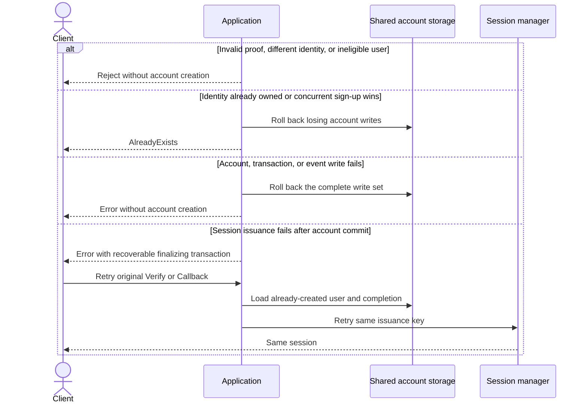

# SIGN_UP — first implementation for owner correction

The owner requested restoration of the application and an implementation-first
review, one flow at a time. This document records the implemented choices, not a
claim that the owner has approved every product or architecture detail.

```mermaid
sequenceDiagram
    actor Client
    participant App as Application
    participant Method as Identity proof method
    participant Tx as Authentication transaction
    participant Store as Shared account storage
    participant Session as Session manager
    Client->>App: Create SIGN_UP transaction
    loop Required proof steps
        Client->>App: Start and Verify or Callback
        App->>Method: Verify identity outside storage locks
        Method-->>App: Verified identity and evidence
        App->>Tx: Bind verified subject, accept evidence, evaluate policy
        Note over App,Tx: Shared binding retains identity and any existing UserID; no account is created
    end
    App->>App: Finalize SIGN_UP: reject registered subject; check proposed user eligibility
    App->>Store: Begin atomic completion
    App->>Tx: Lock transaction and recheck proof and policy
    App->>Store: Check identity ownership and create user and identity
    App->>Tx: Bind user and prepare completion
    App->>Store: Save transaction and events, commit
    opt Session issuance configured
        App->>Session: Issue using stable transaction key
        Session-->>App: Session
    end
    App-->>Client: Completed result
```



| Root | Purpose | Mutation boundary |
| --- | --- | --- |
| Authentication transaction | Collect proof for one registration. | Existing transaction lock, one private identity, bounded evidence, completion and replay receipts. |
| User | Identify the newly registered subject. | Create only, with generated ID and `active` status. No existing user is modified. |
| Identity | Give one verified issuer/subject exactly one owner. | Create with a global unique issuer/subject constraint. Conflicts reject rather than sign in. |
| Session | Represent the issued login credential. | Existing idempotent host session manager, outside storage locks. |

Commands and facts: Start → MethodStarted, AcceptMethodProof → EvidenceAccepted,
BindRegisteredUser → UserRegistered and PolicySatisfied, Complete → AuthenticationCompleted.
These are transaction-owned event snapshots. UserRegistered records the committed
creation/binding fact, without publishing the private identity. Events are records
of synchronous completion, not a new asynchronous consumer route.

## Explicit implementation choices for correction

- SIGN_UP is new-account-only, and cannot start from an already-authenticated caller.
- Shared binding requires the same unresolved kind/issuer/subject, or identities
  resolving to the same existing UserID. No linking or multiple initial identities are inferred.
- Existing-user and UserID-only proofs use shared binding; SIGN_UP rejects them
  only at finalization. A chosen password is not identity proof.
- New users start as `active`; the host eligibility hook may reject creation and
  is checked again before session issuance.
- Session issuance remains optional configuration.
- Password enrollment, profile data, MFA enrollment, UPDATE and DELETE are excluded.

## Transaction-boundary exception under review

This first implementation uses a narrow multi-root creation transaction:
Transaction → create User → create Identity → save binding and events. Existing
users are never locked or modified. Missing-identity races are serialized by
uniqueness at insert. All participating adapters must share one transaction
manager; separate stores cannot implement this contract safely. Provider and host
eligibility calls occur before the transaction, session calls after commit.

The immediate invariant is that no failed registration leaves a user, identity,
or binding behind. A durable staged-registration process could replace this
boundary, but would introduce pending-account and compensation semantics absent
from the requested synchronous first version. This exception is visible for owner
correction, not an amendment to the aggregate-boundary skill. Production storage
adoption must review this boundary and enforce all-or-nothing rollback and unique
identity ownership. In-memory storage serializes writes globally; SQL adapters
must preserve transaction-first locking and unique-identity conflict handling.

Implementation: `VerifyMethod` and `CompleteCallback` share subject resolution and
`Transaction.AcceptMethodProof`. Only finalization selects SIGN_UP.
The shared registration persistence phase lives beside `VerifyMethod` in
`application/service/authentication-service/verify_method.go`.

## Shared binding correction

The owner approved intent-independent binding and evaluation, with differences
only at finalization. Aggregate boundaries and event routes remain unchanged.
`SignUpIdentity` is replaced by `VerifiedIdentity`; host persistence adapters must
map the renamed field. `AcceptMethodProof` returns the policy decision and no longer
prepares completion itself.

```mermaid
sequenceDiagram
    participant Method
    participant App as Verify / Callback
    participant Tx as Authentication transaction
    participant Final as Finalization
    Method-->>App: Verified subject and evidence
    App->>App: Resolve existing UserID when available
    App->>Tx: AcceptMethodProof(subject, evidence)
    Tx->>Tx: Enforce same subject and evaluate policy
    alt Invalid or mismatched proof
        Tx-->>App: Reject without changing state
    else More evidence required
        Tx-->>App: Remaining requirements
    else Policy satisfied
        Tx-->>App: Satisfied decision
        App->>Final: Finalize intent
        alt SIGN_IN
            Final->>Final: Require existing eligible user
        else SIGN_UP
            Final->>Final: Require unregistered identity; create eligible user and identity
        end
        Final-->>App: Completed principal and optional session, or error
    end
```

A finalization error preserves the existing transaction rollback behavior. This
correction does not introduce a new recovery mechanism.
